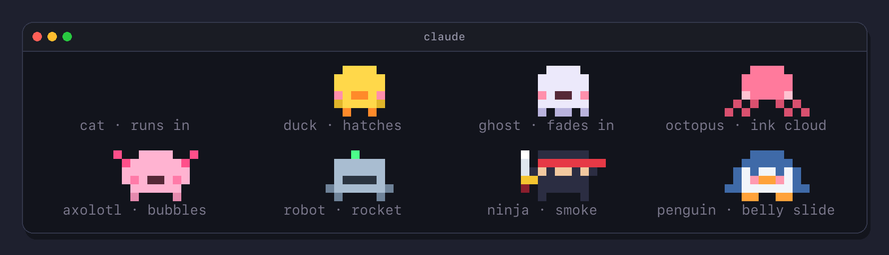

# Pixel Buddy

**Ship code, feed your buddy.**

A pixel pet for Claude Code. It hatches in the footer next to your status line, eats what your work drops, levels up,
earns rare trophies, does tricks while Claude thinks, naps when you are away and plays with you on clicks. Every buddy
you hatch stays in your nest, and nothing leaves your machine.


## Install

At the prompt of a terminal session:

```
/plugin install pixel-buddy --marketplace SimakovIgor/pixel-buddy
```

Answer `y` and pick the user scope to have it in every session. Update and removal are in the plugin's
[README](pixel-buddy/README.md#install).

## A quick look

Click it to pet it, double click for its own move, click an empty spot to throw a ball:


A right click opens the menu with a summary line. `card` shows its card in a frame above the prompt:


Rare moments of your work earn trophies: a commit deep in the night, a snack every day for a week, a legendary egg.
Six are secret. Each one brings a gold cup and fireworks, and `share` copies a card to show it off in any chat:


Eight species, and each one comes and goes in its own way:



Feeding, moods, the nest, trophies, clicks, commands, what the buddy runs and sends, and troubleshooting are in the
plugin's [README](pixel-buddy/README.md).

## In this repository

- `pixel-buddy/`: the plugin, the folder people install
- `tests/`: its tests, kept outside the plugin. Run them with `sh tests/run.sh`
- `.claude-plugin/marketplace.json`: the marketplace `simakovigor` that lists the plugin

## License

MIT
