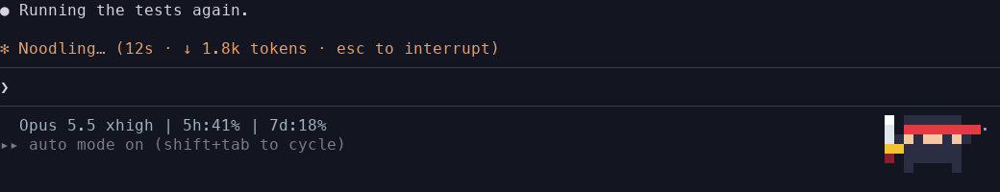
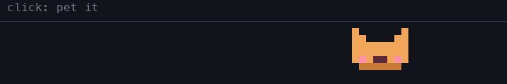
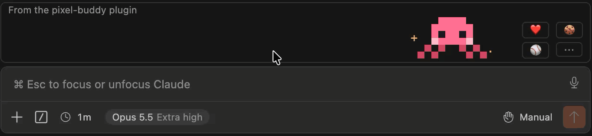
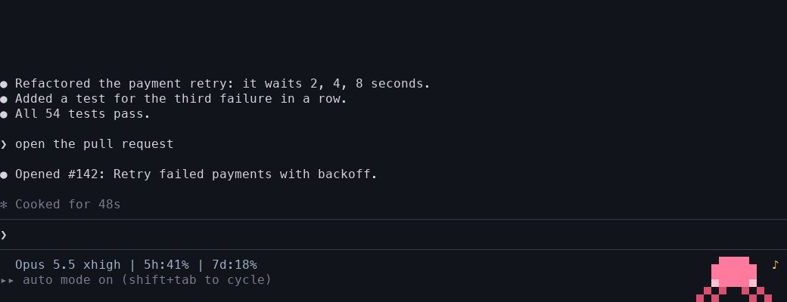
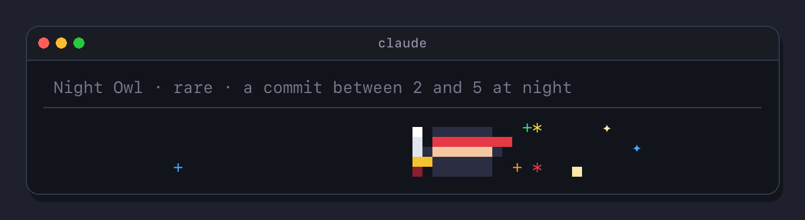
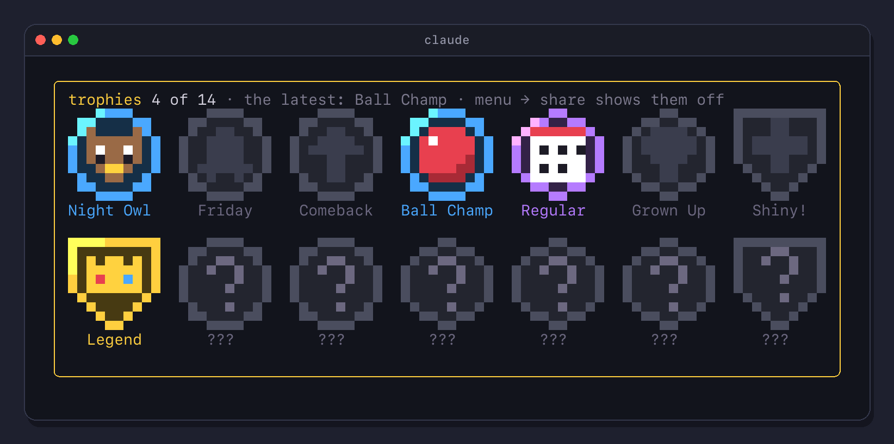
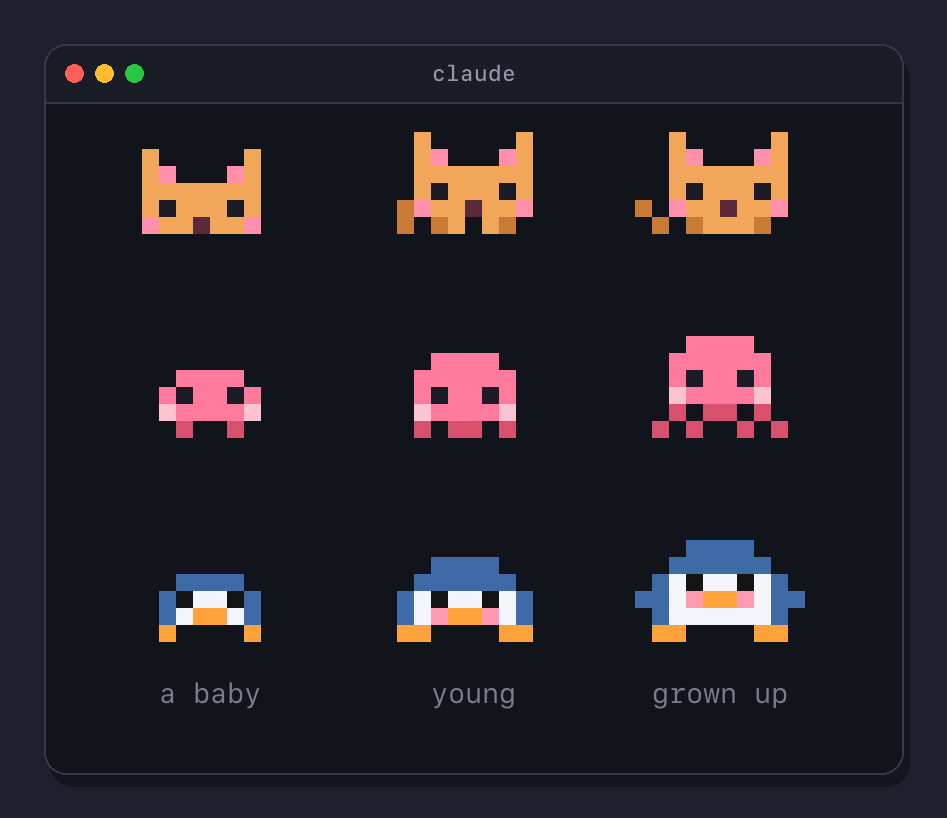

# Pixel Buddy

**Ship code, feed your buddy.**

A pixel pet for Claude Code. It hatches tiny in the footer next to your status line and grows up over three weeks,
eats what your work drops, levels up, earns rare trophies, does tricks and tells facts while Claude thinks, naps when
you are away and plays with you on clicks. Every buddy you hatch stays in your nest, and nothing leaves your machine.



## Install

1. Open Claude Code 2.1.318 or later in a terminal. Older one? Run `claude update`
2. Paste this at the prompt:

   ```
   /plugin install pixel-buddy --marketplace SimakovIgor/pixel-buddy
   ```

3. Answer `y` and pick the user scope, so it hatches in every session

The egg hatches in the footer right away, and in VS Code and Cursor above the prompt. In the desktop app: + next to
the prompt box, Plugins, Add marketplace `SimakovIgor/pixel-buddy`, Add plugin. Update and removal are in the
plugin's [README](pixel-buddy/README.md#install).

It speaks English or Russian: pick the language when you install it, or later with a right click → settings.

If your buddy made you smile, a ⭐ helps other people find it

## A quick look

Click it to pet it, double click for its own move, click an empty spot to throw a ball:



In VS Code and Cursor it sits right above the prompt and lives the same life. A click can't land on a picture there,
so ❤️ 🍪 ⚾ `⋯` next to it pet it, hand it a berry, throw a ball and open the menu:



A right click opens the menu with a summary line. `card` shows its card in a frame above the prompt:



Rare moments of your work earn trophies: a commit deep in the night, a snack every day for a week, a legendary egg.
Six are secret. Each one brings a gold cup and fireworks, and `share` copies a card to show it off in any chat:



Your trophy case opens from the menu, a pixel badge for each trophy. All fourteen and how to earn them, the secret
ones behind a spoiler, are in [TROPHIES.md](TROPHIES.md) ([по-русски](TROPHIES.ru.md)):



Eight species, and each one comes and goes in its own way:


A new buddy hatches tiny: a baby for its first week, young until three weeks, then grown up. It tells you when it
grows, and the little ones running next to it are its helpers, one for each subagent:



Feeding, moods, the nest, trophies, clicks, commands, what the buddy runs and sends, and troubleshooting are in the
plugin's [README](pixel-buddy/README.md).

## In this repository

- `pixel-buddy/`: the plugin, the folder people install
- `tests/`: its tests, kept outside the plugin. Run them with `sh tests/run.sh`
- `TROPHIES.md`, `TROPHIES.ru.md`: every trophy and how to earn it
- `.claude/commands/`: checks for contributors, `/check-surfaces` for every client and `/update-docs` for these docs
- `.claude-plugin/marketplace.json`: the marketplace `simakovigor` that lists the plugin

## License

MIT
