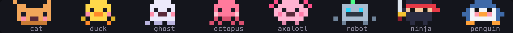

# Pixel Buddy

A pixel pet for Claude Code. It lives in the footer next to your status line, hatches from an egg, reacts to what
Claude does, shows tricks while you wait, naps when you are away and plays with you on clicks.


## Install

At the prompt of a terminal session:

```
/plugin install pixel-buddy --marketplace SimakovIgor/pixel-buddy
```

Answer `y` to add the marketplace, then pick a scope: the user scope keeps the buddy in every session. It shows up in
the current session right away, other open sessions get it after `/reload-plugins`.

From a shell:

```
claude plugin install pixel-buddy --marketplace SimakovIgor/pixel-buddy
```

In the desktop app, click + next to the prompt box, then Plugins, Add marketplace with `SimakovIgor/pixel-buddy`, then
Add plugin.

## Uninstall

At the prompt of a terminal session, or with `claude plugin uninstall pixel-buddy` from a shell:

```
/plugin uninstall pixel-buddy
```

To drop the marketplace as well: `/plugin marketplace remove simakovigor`. The buddy itself stays in Claude Code's
plugin store under `~/.claude/plugins/store`: delete its `pixel-buddy` file there to start again from a new egg.

## Requirements

- Claude Code 2.1.318 or later, in the terminal or in the Code tab of the desktop app
- a terminal with 24-bit color. Clicks need a terminal that reports the mouse: iTerm2, Ghostty, kitty, WezTerm, Warp
- 130 columns or more to sit in the footer. A narrower terminal shows the buddy above the prompt
- word explanations read the selection, which Claude Code offers in fullscreen rendering

## Meet the buddies



Eight species, five rarities, a name and stats of its own. One buddy per machine, shared by all your sessions.

## What it does


- **Stays out of the way.** It sits at the right end of the footer, so Claude's spinner stays right above the prompt and
  the footer keeps its height
- **Comes and goes in its own way.** The duck and the penguin hatch from an egg and waddle away, the ninja appears and
  vanishes in a puff of smoke, the robot lands on a rocket flame and flies off, the cat runs in and out, the ghost
  fades in and out, the octopus uses ink and the axolotl bubbles
- **Reacts to the session.** Thinking dots while Claude works, a jolt on a failed command, dizzy when the same thing
  fails three times in a row, happy on a commit, green tests or a finished plan. A little one runs next to it for
  every subagent
- **Does tricks while you wait.** About every half a minute: the ninja slices flying fruit, the octopus juggles, the
  axolotl blows bubbles, the penguin sings, the cat chases a butterfly, the duck splashes, the ghost says boo and the
  robot scans the floor with a laser
- **Naps when you are away.** After three quiet minutes it lies down under a palm, the ninja under a sakura. When you
  come back or Claude starts working, it hops up and the tree fades away
- **Explains a word.** Select a word in the conversation and click the buddy: a small model types a short explanation
  in a bubble while your session keeps working
- **Tells you who waits.** Buddies of your other sessions on this machine visit your strip. When one of those sessions
  waits for your answer or permission, its buddy waves with a `!` next to the thread's title. Click it to see when
  Claude finished there and what it asked. A session still working in the background does not count as waiting
- **Dresses for the season.** A witch hat and bats around Halloween, a Santa hat and snow in December. The ninja slices
  pumpkins or tangerines then

## It lives on clicks

| Do | What happens |
| --- | --- |
| click it | pet it, or explain the word you selected in the conversation |
| double click | its own move: the ninja teleports in smoke, the robot flies over, the duck dives, the penguin slides on its belly, the cat dashes, the ghost fades over, the octopus goes through ink, the axolotl through bubbles |
| drag it | carry it along the strip, a light trail of fading copies follows it |
| click an empty spot | throw a ball, it runs to catch it. The ninja parries a shuriken |
| right click | the menu: `card` with stats and personality, `change buddy`, `theme`, `hide` |
| click the `!` buddies on the left | which of your sessions wait for you and what Claude asked there |

## Commands

Only for what a click cannot do:

| Command | What it does |
| --- | --- |
| `/buddy` | its card: portrait, stats, personality |
| `/buddy name <name>` | rename it |
| `/buddy on` | bring it back after `hide`, which hides it in the current session only |
| `/buddy help` | the list of clicks and commands |
| `/buddy demo` | every reaction in 25 seconds |

## Privacy and cost

- No tokens and no network by default. The only model call is the word explanation: `haiku`, and only when you select
  a word and click the buddy
- Everything stays on this machine, in the plugin store of Claude Code: the buddy, the theme, and a short status of
  each open session so your other sessions can show who waits for you. That status holds the folder, the branch, the
  task key from the branch name, the thread title, the first words of your first prompt and the last line of Claude's
  answer. The entry of a closed session is removed after a day
- To name a session by its thread title it looks up the session's transcript under `~/.claude/projects` with `find`
  and `grep`, reading the title rows only

## How it works

Pixel Buddy is a Claude Code [mod](https://code.claude.com/docs/en/plugins/mods/overview.md): a hooks module and a
`Client` module that animates in the terminal.

- `hooks/register.tsx` listens to the session: turns, tool calls, the end of a turn with its background work,
  permission prompts, clicks. It draws the strip in the `SessionMode` render site at the right of the footer and falls
  back to the band above the prompt where the footer has no room
- `hooks/band-client.tsx` runs the strip at 20 frames a second: walking, chasing the cursor, catching the ball,
  dragging
- `hooks/scene.ts` paints everything with half-block pixels, two pixels per terminal cell
- `hooks/species.ts` holds the sprites, `hooks/buddy.ts` the stats and the card, `hooks/lines.ts` what it says

## Development

```
git clone https://github.com/SimakovIgor/pixel-buddy
claude --plugin-dir pixel-buddy
```

The session reloads the mod each time you save a file. Tests and checks:

```
claude plugin test pixel-buddy
claude plugin validate pixel-buddy
```

## Troubleshooting

- **It sits above the prompt, not in the footer:** the terminal is narrower than 130 columns
- **Clicks do nothing:** the terminal does not report the mouse to Claude Code
- **A session opened before the install has no buddy:** run `/reload-plugins` there
- **Something looks off:** `/buddy debug` shows how it draws and the last error it met

## License

MIT
