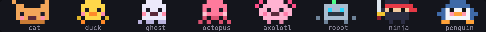
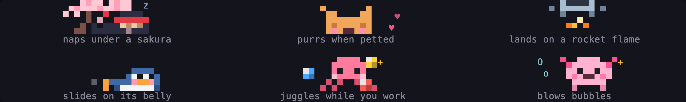
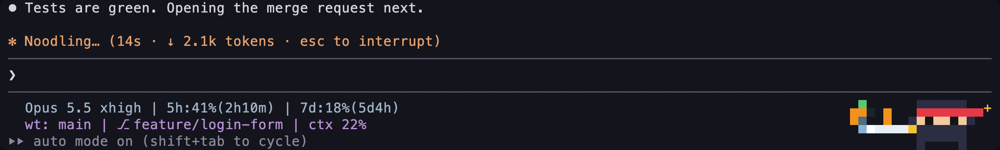

# Pixel Buddy

**Ship code, feed your buddy.**

A pixel pet for Claude Code. It hatches in the footer next to your status line, eats what your work drops, grows a
level at a time, shows its mood, does tricks while Claude thinks, naps when you are away and plays with you on clicks.


## Install

At the prompt of a terminal session:

```
/plugin install pixel-buddy --marketplace SimakovIgor/pixel-buddy
```

Answer `y` to add the marketplace, then pick a scope: the user scope keeps the buddy in every session. It shows up in
the current session right away, other open sessions get it after `/reload-plugins`.

From a shell:

```
claude plugin install pixel-buddy --marketplace SimakovIgor/pixel-buddy
```

In the desktop app, click + next to the prompt box, then Plugins, Add marketplace with `SimakovIgor/pixel-buddy`, then
Add plugin.

## Update

Each release raises the version in `plugin.json`. A plugin from this marketplace does not update by itself until you
turn that on: in `/plugin`, open the Marketplaces tab, select `simakovigor` and choose Enable auto-update. To update now,
open `pixel-buddy` on the Installed tab of `/plugin` and choose Update now, or run
`claude plugin update pixel-buddy@simakovigor` from a shell. The new version loads after `/reload-plugins` or in the next
session.

## Uninstall

At the prompt of a terminal session, or with `claude plugin uninstall pixel-buddy` from a shell:

```
/plugin uninstall pixel-buddy
```

To drop the marketplace as well: `/plugin marketplace remove simakovigor`. The buddy itself stays in Claude Code's
plugin store under `~/.claude/plugins/store`: delete its `pixel-buddy` file there to start again from a new egg.

## Requirements

- Claude Code 2.1.318 or later, in the terminal or in the Code tab of the desktop app
- a terminal with 24-bit color. Clicks need a terminal that reports the mouse: iTerm2, Ghostty, kitty, WezTerm, Warp
- 130 columns or more to sit in the footer. A narrower terminal shows the buddy above the prompt

## Meet the buddies



Eight species. A buddy hatches with a name, a rarity and five stats, all rolled once:

- **Rarity** is the stars on its card: common 60%, uncommon 25%, rare 10%, epic 4%, legendary 1%. Rarer buddies roll
  higher stats
- **Stats** are DEBUGGING, PATIENCE, CHAOS, WISDOM and SNARK. The highest one sets its personality. With CHAOS or SNARK
  on top it teases you, otherwise it cheers you on
- **Shiny:** 1 egg in 100 hatches a buddy in other colors that twinkles now and then

## Feed it with your work

- **Snacks come from what you do.** Each answer from Claude drops a cookie into the strip, green tests drop a fish, a
  commit or a finished plan drops a cake. The buddy walks over and eats it. Click a snack to make it hurry
- **Snacks give xp, xp gives levels.** Each level needs ten xp more than the last one. A new level gets a little party
- **It never starves.** The belly empties slowly, over a night. A hungry buddy asks for a snack now and then, a berry
  from the menu fills it up, and nothing bad happens to it if you forget

## Its mood

The card tells the mood and what helps:

| Mood | When | What it does | What helps |
| --- | --- | --- | --- |
| joyful ♪ | green tests, a commit or a new level in the last half hour | hums, hops, does tricks twice as often | keep shipping |
| content · | fed, petted, rested | its usual self | nothing |
| tired zz | two hours of work without a ten minute break | walks slower, half shuts its eyes, suggests a stretch | a short break |
| lonely ? | nobody pets it for a day | asks for a click | pet it, play ball |
| hungry ~ | the belly is low | asks for a snack | a berry from the menu |

## Your nest

Every buddy you hatch stays in your nest with its level, belly and love, up to 12. A new egg never replaces anyone,
and a buddy resting in the nest does not get hungry or lonely. Each window keeps its own buddy, also after
`claude --resume`, so two windows can show two different buddies. A new window shows your last pick.

## Trophies

Rare moments of your work earn trophies, not every five minutes. Each one brings a gold cup and fireworks in its
rarity color, a toast says what it was for, and the card shows your shelf. `/buddy trophies` lists them all.


| Trophy | Rarity | For |
| --- | --- | --- |
| Night Owl | rare | a commit between 2 and 5 at night |
| Friday Deploy | rare | a commit on a Friday after 6 in the evening |
| Comeback | rare | green tests soon after three failures in a row |
| Ball Champ | rare | ten balls caught in one minute |
| Regular | epic | a snack every day for a week |
| All Grown Up | epic | a buddy at level 10 |
| Shiny! | legendary | a shiny buddy in your nest |
| Legend | legendary | a legendary buddy in your nest |

And six secret ones: the list shows only their rarity until you find them. The code is open, so you can look them
up, but finding them yourself is more fun.

## What else it does



- **Stays out of the way.** It sits at the right end of the footer, so Claude's spinner stays right above the prompt and
  the footer keeps its height
- **Comes and goes in its own way.** The duck hatches from an egg and flies off, the penguin slides in and out on its
  belly, the ninja appears and vanishes in a puff of smoke, the robot lands on a rocket flame and flies away, the cat
  runs in and out, the ghost fades in and out, the octopus uses ink and the axolotl bubbles
- **Reacts to the session.** Thinking dots while Claude works, a jolt on a failed command, dizzy when the same thing
  fails three times in a row, happy on a commit, green tests or a finished plan. A little one runs next to it for
  every subagent
- **Does tricks while you wait.** About every half a minute: the ninja slices flying fruit, the octopus juggles, the
  axolotl blows bubbles, the penguin sings, the cat chases a butterfly, the duck splashes, the ghost says boo and the
  robot scans the floor with a laser
- **Naps when you are away.** After three quiet minutes it lies down under a palm, the ninja under a sakura. When you
  come back or Claude starts working, it hops up and the tree fades away
- **Dresses for the season.** A witch hat and bats around Halloween, a Santa hat and snow in December. The ninja slices
  pumpkins or tangerines then



## It lives on clicks


| Do | What happens |
| --- | --- |
| click it | pet it |
| double click | its own move: the ninja teleports in smoke, the robot flies over, the duck dives, the penguin slides on its belly, the cat dashes, the ghost fades over, the octopus goes through ink, the axolotl through bubbles |
| drag it | carry it along the strip, a light trail of fading copies follows it |
| click an empty spot | throw a ball, it runs to catch it. The ninja parries a shuriken |
| click a snack | it hurries over and eats it with hearts |
| right click | the menu |

## The menu

A right click opens it. Its first line sums the buddy up: name, level, belly, love and mood.


| Item | What it does |
| --- | --- |
| `card` | opens its card in a frame above the prompt: portrait, mood, level, belly and love. `hide card` closes it, or it goes away in a minute |
| `feed` | gives it a berry. A full buddy says no thanks |
| `buddies` | opens your nest: bring any buddy back to this window or hatch a new egg |
| `theme` | calendar, winter, halloween or off |
| `hide` | hides it in this window. `/buddy on` brings it back |

## Commands

Only for what a click cannot do:

| Command | What it does |
| --- | --- |
| `/buddy` | its full card in the chat: portrait, mood, level, belly, love, rarity, stats, personality |
| `/buddy feed` | give it a berry |
| `/buddy trophies` | the trophies you found and the ones still open |
| `/buddy name <name>` | rename it |
| `/buddy on` | bring it back after `hide`, which hides it in the current session only |
| `/buddy help` | the list of clicks and commands |
| `/buddy demo` | every reaction in 25 seconds |

## What it runs and sends

- **Nothing leaves your machine.** No network calls, no model calls, no tokens spent
- **It runs no programs and reads no files**
- **What it keeps, on this machine only,** in the plugin store of Claude Code: your buddies with their names, stats,
  xp, belly and love, which buddy each of your last 50 sessions shows, the trophies you found with their dates, the
  last day it ate and how many days in a row, the theme and the hat switch. Entries an older version kept are removed
  when a session starts
- **Your conversation stays out of it.** It reads no prompts, answers or thread titles. It looks at tool calls only to
  react, for example to a Bash command that runs tests, and keeps none of them
- **Hooks only watch.** Every hook passes its event on unchanged: the buddy never edits your prompts, tool calls,
  permissions or settings. The `/buddy` command is the one it adds

## How it works

Pixel Buddy is a Claude Code [mod](https://code.claude.com/docs/en/plugins/mods/overview.md): a hooks module and a
`Client` module that animates in the terminal.

- `hooks/register.tsx` listens to the session: turns, tool calls, subagents, clicks. Five times a second it decides
  the mood and what to say. It draws the strip in the `SessionMode` render site at the right of the footer and falls
  back to the band above the prompt where the footer has no room. The card is drawn in that band too
- `hooks/band-client.tsx` animates the strip at 20 frames a second: walking, chasing the cursor, catching the ball,
  dragging. A frame that looks like the last one is not redrawn, so an idle buddy costs little
- `hooks/scene.ts` paints everything with half-block pixels, two pixels per terminal cell
- `hooks/species.ts` holds the sprites, `hooks/buddy.ts` the stats and the card, `hooks/lines.ts` what it says,
  `hooks/trophies.ts` the trophies and when each one is earned

## Development

The repository holds the plugin in `pixel-buddy/` and its tests in `tests/`, outside the plugin, so installing the
plugin does not bring the tests along. From the root of a clone:

| Task | Command |
| --- | --- |
| run the plugin in a session, reloading on save | `claude --plugin-dir pixel-buddy` |
| run the tests on a temporary copy of the plugin | `sh tests/run.sh` |
| check the manifest and the hooks module | `claude plugin validate --strict pixel-buddy` |

## Troubleshooting

- **It sits above the prompt, not in the footer:** the terminal is narrower than 130 columns
- **Clicks do nothing:** the terminal does not report the mouse to Claude Code
- **A session opened before the install has no buddy:** run `/reload-plugins` there
- **`card` shows nothing:** the panel above the prompt is folded, its `[-]` folds it. Click the line
  `▸ plugin panel hidden` right above the prompt to unfold it, Claude Code remembers that
- **Something looks off:** `/buddy debug` shows how it draws, the last click and menu press, the card and the last
  error it met

## License

MIT
