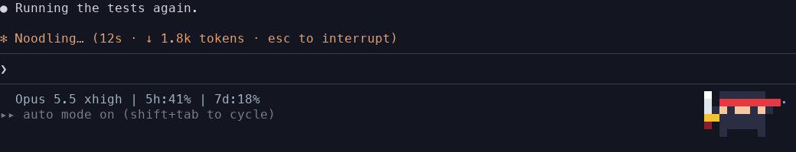
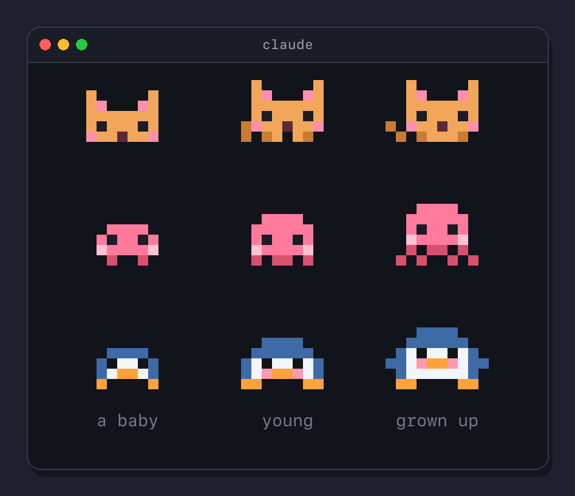
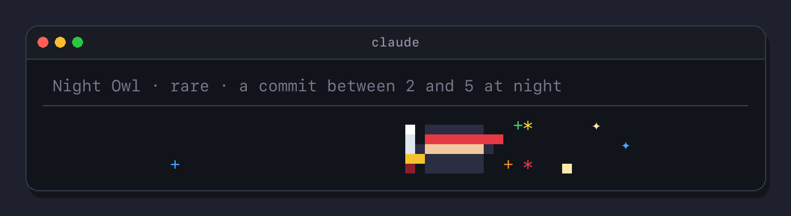
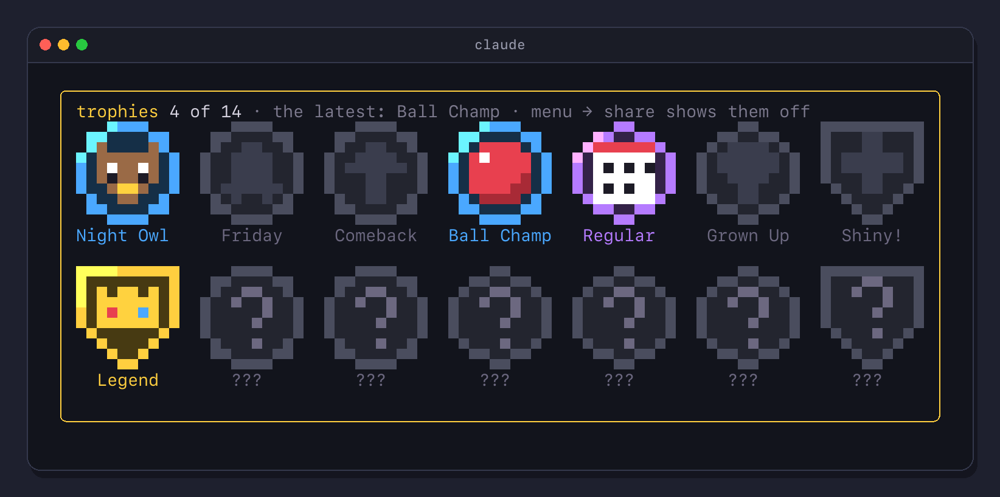
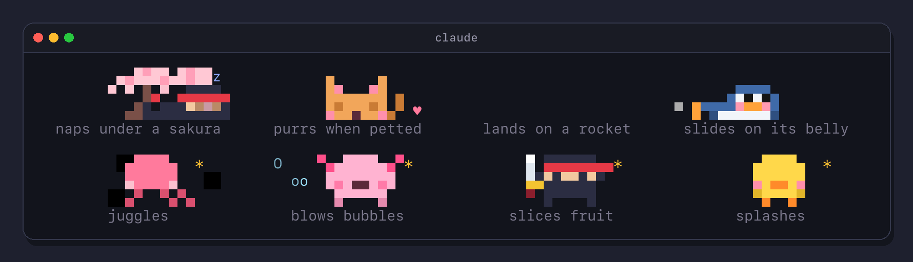
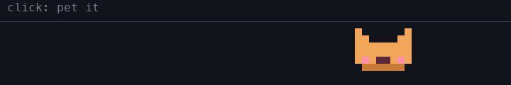
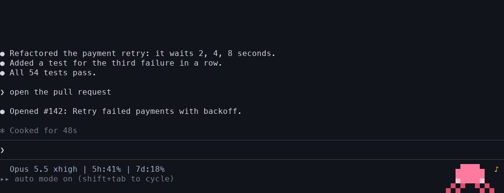

# Pixel Buddy

**Ship code, feed your buddy.**

A pixel pet for Claude Code. It hatches tiny in the footer next to your status line and grows up over three weeks,
eats what your work drops, levels up, earns rare trophies, does tricks and tells facts while Claude thinks, naps when
you are away and plays with you on clicks. In VS Code and Cursor it lives right above the prompt.



## Install

At the prompt of a terminal session, then answer `y` and pick the user scope to have it in every session:

```
/plugin install pixel-buddy --marketplace SimakovIgor/pixel-buddy
```

- **From a shell:** `claude plugin install pixel-buddy --marketplace SimakovIgor/pixel-buddy`
- **In the desktop app:** + next to the prompt box, Plugins, Add marketplace `SimakovIgor/pixel-buddy`, Add plugin
- **Update:** `/plugin`, Installed, `pixel-buddy`, Update now. Or turn on auto-update for `simakovigor` on the
  Marketplaces tab
- **Remove:** `/plugin uninstall pixel-buddy`. Your buddies stay in `~/.claude/plugins/store`, delete the `pixel-buddy`
  file there to start from a new egg
- **Language:** English or Русский. Pick it when you install, later in the menu under `settings`, or in `/config`, the
  `Language · Язык` row of pixel-buddy. The buddy, its menu, card, trophies and facts all switch

Sessions opened before the install get it after `/reload-plugins`.

## Requirements

- Claude Code 2.1.318 or later, in the terminal, the Code tab of the desktop app, or the Claude Code extension for
  VS Code and Cursor. In the editor the buddy sits right above the prompt and behaves as in the terminal; clicks go
  through ❤️ 🍪 ⚾ `⋯` next to it, since the editor does not let a click land on a picture. `/buddy panel` opens it
  on the right
- in a terminal: 24-bit color. Clicks need a terminal that reports the mouse: iTerm2, Ghostty, kitty, WezTerm, Warp
- 130 columns or more to sit in the footer. A narrower terminal shows the buddy above the prompt

## Meet the buddies


A buddy hatches with a name, a rarity and five stats, all rolled once:

- **Rarity:** common 60%, uncommon 25%, rare 10%, epic 4%, legendary 1%. Rarer buddies roll higher stats
- **Stats:** DEBUGGING, PATIENCE, CHAOS, WISDOM and SNARK. The highest sets its personality: with CHAOS or SNARK on top
  it teases you, otherwise it cheers you on
- **Shiny:** 1 egg in 100 hatches in other colors and twinkles
- **Grows up:** a baby for its first week, young until three weeks, then grown up. It says so when it grows, and the
  card tells how long is left. Buddies hatched before version 0.13 are grown up already



## Feed it with your work

Each answer from Claude drops a cookie into the strip, green tests drop a fish, a commit or a finished plan drops a
cake. The buddy walks over and eats it. Snacks give xp, xp gives levels, and each level needs ten xp more than the last.

It never starves: the belly empties over a night, a hungry buddy asks for a snack, and your work or `/buddy feed` fills it.

## Its mood

The card tells the mood and what helps:

| Mood | When | What it does | What helps |
| --- | --- | --- | --- |
| joyful ♪ | green tests, a commit or a new level in the last half hour | hums, hops, does tricks twice as often | keep shipping |
| content · | fed, petted, rested | its usual self | nothing |
| tired zz | two hours of work without a ten minute break | walks slower, half shuts its eyes, suggests a stretch | a short break |
| lonely ? | nobody pets it for a day | asks for a click | pet it, play ball |
| hungry ~ | the belly is low | asks for a snack | your work or `/buddy feed` |

## Your nest

Every buddy you hatch stays in your nest with its level, belly and love, one of each species. A new egg never
replaces anyone: a random one picks a species you don't have yet, and asking for one you have calls that buddy back.
A buddy resting in the nest does not get hungry or lonely. Each window keeps its own buddy, also after
`claude --resume`. A new window shows your last pick.

## Trophies

Rare moments of your work earn trophies. Each one brings a gold cup and fireworks in its rarity color, and a toast
says what it was for.



| Trophy | Rarity | For |
| --- | --- | --- |
| Night Owl | rare | a commit between 2 and 5 at night |
| Friday Deploy | rare | a commit on a Friday after 6 in the evening |
| Comeback | rare | green tests soon after three failures in a row |
| Ball Champ | rare | ten balls caught in one minute, a ninja's shurikens count too |
| Regular | epic | a snack every day for a week |
| All Grown Up | epic | a buddy at level 10 |
| Shiny! | legendary | a shiny buddy in your nest |
| Legend | legendary | a legendary buddy in your nest |

Six more are secret: they show a question mark until you find them. Finding them yourself is more fun, and the
spoilers are in [TROPHIES.md](../TROPHIES.md).

`trophies` in the menu or `/buddy trophies` opens your trophy case above the prompt. Each trophy is a pixel badge:
round for rare, a hexagon for epic, a shield for legendary. In the desktop app the case shows each trophy's emoji
instead.



**Show it off.** `share` in the menu puts a card of your buddy on the clipboard, drawn in colored squares that every
chat shows:

```
Noodle, my legendary octopus · level 3
⬜⬜⬜🟪🟪🟪🟪⬜⬜⬜
⬜⬜🟪🟪🟪🟪🟪🟪⬜⬜
⬜⬜🟪⬛🟪🟪⬛🟪⬜⬜
⬜⬜🟪🟪🟪🟪🟪🟪⬜⬜
⬜🟥⬜🟥⬜⬜🟥⬜🟥⬜
🟥⬜🟥⬜⬜⬜⬜🟥⬜🟥
🏆 3 of 14 trophies: 👑 🦉 ⚽
Pixel Buddy for Claude Code: github.com/SimakovIgor/pixel-buddy
```

## What else it does



- **Stays out of the way.** It sits at the right end of the footer: the spinner stays above the prompt and the footer
  keeps its height
- **Reacts to the session.** Thinking dots while Claude works, a jolt on a failed command, dizzy after three failures
  in a row, happy on a commit, green tests or a finished plan. A baby of its own kind hops next to it for every
  running subagent
- **Does tricks while you wait,** about every half a minute, each species its own
- **Tells facts on a long answer:** a hundred of them about space, Earth, code, math and philosophy, the first half a
  minute in, then one every two minutes while Claude works, never while you type. `facts` in the menu turns them off,
  `/buddy fact` asks for one now
- **Comes and goes in its own way:** an egg, a puff of smoke, a rocket, a belly slide, ink, bubbles
- **Naps when you are away.** After three quiet minutes it lies down under a palm, the ninja under a sakura
- **Dresses for the season:** a witch hat and bats around Halloween, a Santa hat and snow in December

## It lives on clicks



| Do | What happens |
| --- | --- |
| click it | pet it |
| double click | its own move: the ninja teleports in smoke, the robot flies over, the penguin slides on its belly |
| drag it | carry it along the strip |
| click an empty spot | throw a ball, it runs to catch it. The ninja parries a shuriken |
| click a snack | it hurries over and eats it |
| right click | the menu |

In VS Code and Cursor a click cannot land on a picture, so the same moves are buttons next to the buddy: ❤️ pets it,
🍪 hands it a berry, ⚾ throws a ball, `⋯` opens the menu.

## The menu

A right click opens it, `⋯` in VS Code and Cursor. Its first line sums the buddy up: name, level, belly, love and mood.



| Item | What it does |
| --- | --- |
| `card` | its card in a frame above the prompt: portrait, mood, level, belly, love and the trophy shelf |
| `buddies` | your nest: bring any buddy back to this window or hatch a new egg |
| `trophies` | your trophy case above the prompt |
| `share` | a card of your buddy and its trophies on the clipboard |
| `settings` | language (English or Русский), theme (calendar, winter, halloween or off), facts on or off, and hide, which hides it in this window until `/buddy on` |

## Commands

| Command | What it does |
| --- | --- |
| `/buddy` | its full card in the chat, stats and personality included. In the editor, a one line summary |
| `/buddy trophies` | opens the trophy case |
| `/buddy share` | the share card, copied and printed |
| `/buddy name <name>` | rename it |
| `/buddy feed` | a berry |
| `/buddy fact` | a fact right now |
| `/buddy facts on`, `/buddy facts off` | facts while Claude works |
| `/buddy on` | bring it back after `hide` |
| `/buddy hatch <species>` | a new egg of that species, or calls yours back from the nest |
| `/buddy panel` | in VS Code and Cursor, opens the buddy in a panel on the right |
| `/buddy demo` | every reaction in 25 seconds |
| `/buddy help` | clicks and commands |

## What it runs and sends

- **Nothing leaves your machine.** No network calls, no model calls, no tokens spent. It runs no programs and reads
  no files
- **Your conversation stays out of it.** It reads no prompts, answers or thread titles. It looks at tool calls only
  to react, for example to a Bash command that runs tests, and keeps none of them
- **What it keeps, on this machine only,** in the plugin store of Claude Code: your buddies with their stats, xp,
  belly, love and how grown up they are, which buddy each of your last 50 sessions shows, the trophies with their dates, how many days in a
  row it ate, whether facts are on and which one comes next, the theme
- **The clipboard only when you ask:** `share` copies its card, nothing else
- **Hooks only watch.** Every hook passes its event on unchanged: the buddy never edits your prompts, tool calls,
  permissions or settings

| Hook | What it does with it |
| --- | --- |
| `session.start` | loads your buddy, registers `/buddy`, starts the frames |
| `session.attach` | notes that a VS Code or Cursor window is attached, so the buddy is drawn above its prompt |
| `command.run` | answers `/buddy` only. Every other command passes by untouched |
| `prompt.edit` | notes that you are typing, so the buddy keeps quiet. The text stays as you typed it |
| `prompt.submit` | wakes the buddy and closes an open card. The prompt goes on unchanged |
| `turn.start`, `turn.complete` | thinking face while Claude works, a cookie when the answer comes |
| `tool.call` | looks at the result: a jolt on a failure, a fish for green tests, a cake for a commit or a finished plan. The call and its result go on unchanged |
| `ui.message` | clicks and menu presses on the buddy's own strip. Messages for anything else pass by |
| `ui.render` | draws the strip in the footer or above the prompt, next to what is already there, and in the editor the buttons next to it |

Subagents are counted from the list of running agents, without a hook on their start.

## How it works

Pixel Buddy is a Claude Code [mod](https://code.claude.com/docs/en/plugins/mods/overview.md):

- `hooks/register.tsx` listens to the session, decides the mood and what to say five times a second, and draws the
  strip at the right of the footer, or above the prompt where the footer has no room
- `hooks/band-client.tsx` animates the strip at 20 frames a second and skips frames that did not change
- `hooks/vscode.ts` turns the same frames into pictures for VS Code and Cursor: each picture carries the next 600 ms
  of frames and a new one goes out as it runs out or the scene changes, so the buddy moves as smoothly as in the
  terminal.
  Its words take the editor's text color and pale pixels get a faint outline, so it reads on light and dark themes.
  A few minutes after you leave it falls asleep in one picture that does not change until you are back, so an
  editor left in the background has nothing new to draw
- `hooks/scene.ts` paints with half-block pixels, two per terminal cell
- `hooks/species.ts` the sprites, `hooks/buddy.ts` stats and the card, `hooks/lines.ts` what it says,
  `hooks/trophies.ts` the trophies, `hooks/badges.ts` their pixel badges, `hooks/share.ts` the share card

## Development

The plugin is in `pixel-buddy/`, its tests in `tests/`, so installing the plugin does not bring the tests along:

| Task | Command |
| --- | --- |
| run it in a session, reloading on save | `claude --plugin-dir pixel-buddy` |
| run the tests on a temporary copy | `sh tests/run.sh` |
| check the manifest and the hooks module | `claude plugin validate --strict pixel-buddy` |

## Troubleshooting

- **It sits above the prompt, not in the footer:** the terminal is narrower than 130 columns
- **Clicks do nothing:** the terminal does not report the mouse to Claude Code
- **`card` shows nothing:** the panel above the prompt is folded. Click the line `▸ plugin panel hidden` right above
  the prompt to unfold it
- **Not there in VS Code or Cursor:** update the Claude Code extension, then `/buddy debug` should say `above the
  prompt asked on: vscode`. In Cursor the extension runs in the editor window, not in the Agents window
- **Only its name or "Picture not shown in this editor":** the editor paused its pictures, the buddy is back within
  a minute or two. If it stays away, update the buddy and reload the window
- **Something looks off:** `/buddy debug` shows how it draws, the last click and menu press and the last error

## License

MIT
